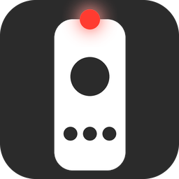
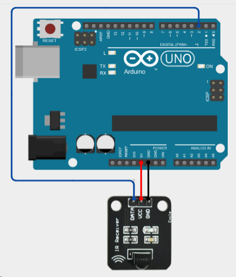

<div align="center">



# IR comp control

[](https://github.com/Rocaccel/ir-comp-control/releases/latest)
[](https://go.dev)
[](https://www.microsoft.com/windows)
[](LICENSE)

Легковесная утилита для Windows на Go, превращающая ИК-пульт в контроллер компьютера: эмуляция клавиатуры, умная мышь с логарифмическим ускорением, медиа-команды и безопасное выключение ПК. Работает из системного трея.

**Русский** | [English](README.en.md)

</div>

---

## Архитектура

```text
ИК-пульт → ИК-приёмник (D2, 5V, GND, 115200) → Arduino Uno (IRremote) → COM-порт → Go-приложение → WinAPI
```

Скетч `for_arduino_controller/IR-controler-dual.ino` декодирует NEC/RC5 и печатает строки вида `NEC_36` или `RC5_36`. Приложение сопоставляет коды с `config.toml` и эмулирует действия.

---

## Возможности

- **Эмуляция клавиатуры** — A–Z, 0–9, F1–F12, навигация, медиа-клавиши.
- **Умная мышь** — перемещение с ускорением.
- **Безопасное выключение** — 10-секундный таймер с отменой любой кнопкой пульта или закрытием окна.
- **Живая перезагрузка конфига** — правки кнопок применяются без перезапуска; при смене порта или скорости программа сообщит, что нужен перезапуск.
- **Режим отладки** — одно окно с кодом кнопки, обновляется в реальном времени.
- **Мультипротокол** — NEC и RC5 одновременно, протокол определяется автоматически.
- **Системный трей** — статус, перезагрузка и редактирование конфига, выход.

---

## Требования

- **Arduino** Uno или совместимая плата.
- **ИК-приёмник** TSOP4838 / VS1838B (любой приёмник NEC с 3 выводами).
- **ИК-пульт** NEC или RC5.
- **Windows** 7 / 10 / 11; **Go 1.26+** — только для сборки из исходников.
- **Библиотека IRremote 4.x** — для прошивки Arduino.

---

## Быстрый старт

### 1. Подключение приёмника

OUT → D2, VCC → 5V, GND → GND.

<div align="center">


</div>

### 2. Прошивка Arduino

Установите библиотеку IRremote (через Arduino IDE или `arduino-cli lib install IRremote`), откройте `IR-controler-dual.ino`, выберите плату и порт, загрузите.

Проверьте в Мониторе порта (115200): нажимайте кнопки на пульте — печатаются `NEC_XX` / `RC5_XX`.

### 3. Запуск

**Через Scoop** (с автообновлениями):

```sh
scoop bucket add rocaccel https://github.com/Rocaccel/scoop-bucket
scoop install ir-comp-control
```

Обновление: `scoop update ir-comp-control`.

**Portable:** скачайте [](https://github.com/Rocaccel/ir-comp-control/releases/latest) и положите в любую папку.

1. Запустите — при первом запуске рядом создастся `config.toml`.
2. Пропишите в `config.toml` номер своего COM-порта и запустите заново.

> [!IMPORTANT]
> Перед запуском приложения закройте Монитор порта Arduino IDE и любые программы, занимающие COM-порт. Иначе утилита не сможет работать с ним.

---

## Настройка

`config.toml` рядом с exe:

```toml
port = "COM4"
baud = 115200

[buttons]
"NEC_36" = "SYSTEM_SHUTDOWN"
"NEC_10" = "WIN_D"
"NEC_B"  = "ALT_TAB"
"NEC_5A" = "MOUSE_UP"
```

Коды кнопок — из Монитора порта; действия — из списка: `SYSTEM_SHUTDOWN`, `WIN_D`, `ALT_TAB`, `ALT_F4`, `VK_F1`–`VK_F12`, `MOUSE_UP/DOWN/LEFT/RIGHT`, `L_CLICK`, `VK_SPACE`, `VK_ENTER`, `VK_ESC`, `VK_BACKSPACE`, `VK_TAB`, `VK_CAPSLOCK`, `VK_MUTE`, `VK_VOLUME_UP/DOWN`, `VK_MEDIA_NEXT_TRACK`, `VK_MEDIA_PREV_TRACK`, `VK_MEDIA_PLAY_PAUSE`, `VK_PRINTSCREEN`, `VK_PAUSE`, `VK_HOME/END/PRIOR/NEXT/UP/DOWN/LEFT/RIGHT`, цифры, буквы.

> [!NOTE]
> `config.toml` встроен в exe и распаковывается рядом только при первом запуске — существующий файл никогда не перезаписывается. Правки кнопок подхватываются кнопкой «Перезагрузить конфиг» без перезапуска; смена `port` или `baud` требует перезапуска приложения.

---

## Как это работает

**Ускорение мыши.** Базовый шаг — 10 px. С четвёртого последовательного нажатия шаг растёт как `10 + 60 * ln(1 + (n - 3))`. Счётчик сбрасывается при паузе дольше 160 мс или смене направления.

**Выключение.** При `SYSTEM_SHUTDOWN` играет звук и открывается окно с таймером. Отмена — любой кнопкой пульта или закрытием окна; в обоих случаях окно закрывается и ПК остаётся включённым.

**Дебаунс.** 150 мс для всех действий, кроме движения мыши.

---

## Режим отладки

Включите чекбокс «Режим отладки» в меню трея. Появится окно «Жду код с пульта»: каждое нажатие кнопки показывает его код (`NEC_XX` / `RC5_XX`) в реальном времени. Скопируйте код в `config.toml`, сохраните, нажмите «Перезагрузить конфиг». Закрытие окна выключает режим.

---

## Сборка

```cmd
cd src_golang
go mod tidy
go build -trimpath -ldflags "-s -w -H=windowsgui -X main.version=v0.2.0" -o ..\ir-comp-control_v0.2.0-win64.exe .
```

Флаги:

- `-H=windowsgui` — без консольного окна;
- `-s -w` — уменьшенный размер;
- `-X main.version=vX.Y.Z` — версия, отображаемая в меню трея (подставьте свою).

`rsrc_windows_amd64.syso` содержит иконку — при замене `icon.ico` перегенерируйте его командой `rsrc -ico icon.ico -o rsrc_windows_amd64.syso`.

---

## Устранение неполадок

- **Команда не отрабатывает** — убедитесь, что в Мониторе порта печатаются `NEC_XX` / `RC5_XX`, и проверьте коды в `config.toml`.
- **Порт не открывается** — закройте Монитор порта Arduino IDE и другие программы, работающие с портом; проверьте `port` и `baud` в `config.toml`.
- **Мышь дёргается после старта** — это нормально: ускорение набирается с четвёртого нажатия.
- **Приёмник молчит** — проверьте подключение D2/5V/GND, батарейки в пульте, направление на приёмник.
